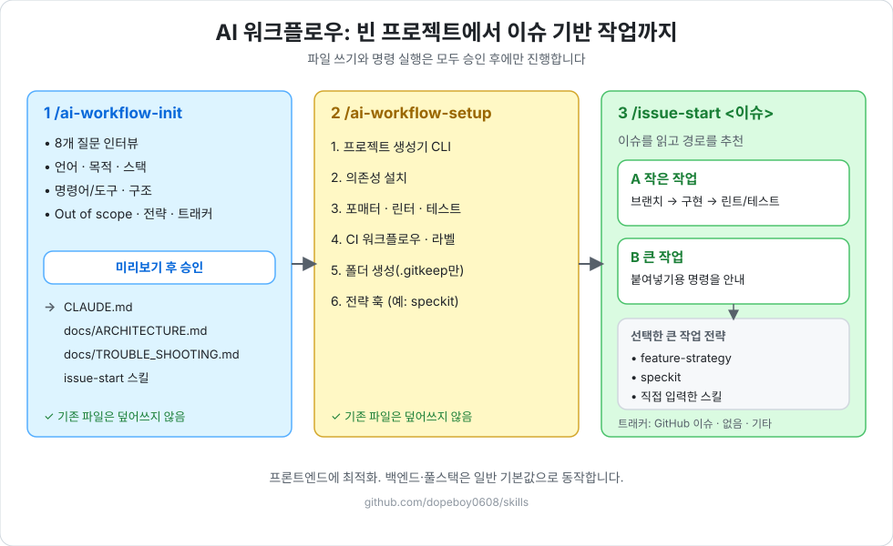

# dopeboy skills

> 🇺🇸 [English README](./README.md)

기능 설계, 코드 리팩터링, 정렬을 위한 AI 에이전트 스킬 모음입니다. **Claude Code**, **OpenCode**, **Cursor**, **Codex**, **Windsurf** 등 [skills.sh](https://skills.sh) 형식을 지원하는 모든 에이전트에서 사용할 수 있습니다.

| 스킬 | 설명 |
| --- | --- |
| [`feature-strategy`](./skills/feature-strategy/SKILL.ko.md) | 기획·디자인이 큰 피처를 "큰 흐름 먼저, 상세는 점진적으로" 구현합니다. 스토리 요구사항 정의 → 하위 작업 로드맵 → 하위 작업별 구현 순서로 진행하며, **커밋 전마다 사람이 확인**합니다. API 계약이 미정이어도 진행할 수 있는 mock 전략을 포함합니다. |
| [`fowler-refactor`](./skills/fowler-refactor/SKILL.ko.md) | 마틴 파울러의 리팩터링 카탈로그를 적용합니다. 인터뷰 → Before/After 제안 → 승인 후 적용 순서로 진행하며, **기존 호출처에 Breaking Change가 없습니다.** |
| [`code-organizer`](./skills/code-organizer/SKILL.ko.md) | React/TypeScript 코드의 import와 훅·상태·ref·이펙트 선언을 **로직 변경 없이** 정렬합니다. |
| [`ai-workflow-init`](./skills/ai-workflow-init/SKILL.ko.md) | 빈 프로젝트 또는 기존 프로젝트에서 8개 질문 인터뷰로 AI 워크플로우 규칙 문서(`CLAUDE.md`, `docs/ARCHITECTURE.md`, `docs/TROUBLE_SHOOTING.md`, `issue-start` 스킬)를 생성합니다. 큰 작업 워크플로우(`feature-strategy`, `speckit`, 직접 입력, 없음)와 이슈 트래커(GitHub 이슈, 없음, 기타)를 선택할 수 있습니다. AI 워크플로우를 처음 도입해보는 사람이나 최소한의 내용으로 구성하고 싶은 사람에게 추천하며, 다음으로 `/ai-workflow-setup`을 실행합니다. |
| [`ai-workflow-setup`](./skills/ai-workflow-setup/SKILL.ko.md) | init 이후 개발환경을 설정합니다: 스캐폴딩 CLI(승인 후), 프론트/백 디렉터리, 포매터·린터·테스트 도구와 CI, 도구 확인(`gh`, 플러그인, 선택한 전략의 CLI). 재실행해도 안전합니다. |

각 스킬 폴더의 `SKILL.ko.md`는 사람이 읽기 위한 한국어 번역본입니다. 에이전트는 `SKILL.md`만 읽습니다.

---

## 설치

두 방법 중 **하나만** 고르세요. Claude Code에 둘 다 설치하면 같은 스킬이 두 번씩 보입니다.

### Claude Code (플러그인)

```bash
claude plugin marketplace add dopeboy0608/skills
claude plugin install dopeboy0608-skills
```

세션 안에서는 `/plugin marketplace add dopeboy0608/skills`, `/plugin install dopeboy0608-skills`, `/reload-plugins` 순서로 실행합니다.

플러그인으로 설치한 스킬은 앞에 플러그인 이름이 붙어 `/dopeboy0608-skills:feature-strategy`, `/dopeboy0608-skills:fowler-refactor`, `/dopeboy0608-skills:code-organizer`, `/dopeboy0608-skills:ai-workflow-init`, `/dopeboy0608-skills:ai-workflow-setup`로 표시되고 실행됩니다.

### 모든 에이전트 (npx)

Claude Code, OpenCode, Cursor, Codex, Windsurf 등에서 쓸 수 있습니다. **Node.js >= 22.20.0**이 필요합니다 (`nvm install 22 && nvm use 22`).

```bash
# 인터랙티브: 스킬과 에이전트를 직접 선택 (현재 프로젝트에 설치)
npx skills@latest add dopeboy0608/skills

# 전역 설치: 모든 프로젝트에서 사용
npx skills@latest add dopeboy0608/skills -g

# 특정 스킬만 설치
npx skills@latest add dopeboy0608/skills --skill fowler-refactor

# 특정 에이전트에만 설치
npx skills@latest add dopeboy0608/skills --skill code-organizer --agent opencode
```

이 방법으로 설치한 스킬은 `/feature-strategy`, `/fowler-refactor`, `/code-organizer`, `/ai-workflow-init`, `/ai-workflow-setup`으로 실행합니다. Claude Code에서는 설치 후 재시작하거나 세션에서 `/reload-skills`를 실행하세요.

### 업데이트

```bash
# 플러그인
claude plugin marketplace update dopeboy-skills
claude plugin update dopeboy0608-skills

# npx
npx skills@latest update
```

### 제거

```bash
# 플러그인
claude plugin uninstall dopeboy0608-skills
claude plugin marketplace remove dopeboy-skills

# npx
npx skills@latest remove fowler-refactor
npx skills@latest remove --global code-organizer
```

---

## feature-strategy

```
/feature-strategy                     # npx
/dopeboy0608-skills:feature-strategy  # Claude 플러그인
```

**자동으로 실행되지 않습니다.** 위 명령어로 명시적으로 호출하세요.

- **Phase A, 스토리 사전 정의**: 디자인 → 요구사항 문서(화면 구성, FR, 필드, 정책, 확인 필요 사항)를 스토리 본문에 정리합니다.
- **Phase B, 하위 작업 플래닝**: 스토리를 코드와 크로스체크하고, 질문 라운드를 거쳐 로드맵과 하위 작업을 만듭니다.
- **Phase C, 하위 작업 단위 구현**: 하위 작업 하나를 구현하고 커밋 전에 멈춰 확인받은 뒤 다음 작업을 보강합니다.
- 사실 조사는 에이전트가, 결정은 사람이 합니다. 기존 컴포넌트는 고치지 않고 대체하므로 롤백은 한 줄입니다.
- 이슈 트래커(Jira, Linear 등) 쓰기는 초안을 승인한 뒤에만 실행합니다.

---

## ai-workflow-init / ai-workflow-setup

**AI 워크플로우를 처음 도입해보는 사람**, 또는 **복잡한 설정 없이 최소한의 내용으로 구성하고 싶은 사람**에게 추천합니다. 빈 프로젝트(또는 기존 프로젝트)에서 순서대로 실행하세요.

```
/ai-workflow-init                     # npx
/dopeboy0608-skills:ai-workflow-init  # Claude 플러그인
/ai-workflow-setup                    # npx
/dopeboy0608-skills:ai-workflow-setup # Claude 플러그인
```



그림으로 보는 가이드(한국어 / English): [가이드 열기](https://claude.ai/artifact/VqLZoureu5Rr1EnTmx8kc2)

자동으로 트리거되지 않습니다. 외부 템플릿 레포를 clone하거나 조회하지 않으며, 필요한 자료는 모두 스킬의 `references/`에 들어 있습니다.

1. **`ai-workflow-init`**: 8개 질문 인터뷰(문서 언어, 목적/범위, 기술 스택, 명령어, 디렉터리, Out of scope, 큰 작업 워크플로우, 이슈 트래커) 후 **쓸 파일 전체를 미리보기**로 보여 줍니다. 승인 전에는 아무것도 쓰지 않고, 기존 파일은 덮어쓰지 않습니다. `CLAUDE.md`, `docs/ARCHITECTURE.md`, `docs/TROUBLE_SHOOTING.md`, `issue-start` 스킬을 만들며, 재실행하면 빠진 것만 채웁니다.
2. **`ai-workflow-setup`**: 프론트/백엔드/풀스택을 판단하고, **명령을 확인받은 뒤** 스캐폴딩 CLI(Vite, Next.js 등)를 실행합니다. 빠진 디렉터리를 보충하고 `CLAUDE.md`의 명령어·기술 스택을 실제 결과로 맞추며, 필요한 도구(`gh`, `dopeboy0608-skills` 플러그인)를 확인합니다. 재실행해도 안전합니다.
3. **`issue-start`**(프로젝트에 생성됨): GitHub 이슈를 읽고 작은 작업(직접 구현)과 큰 작업 중 하나를 추천하며, 큰 작업이면 선택한 전략의 붙여넣기용 명령을 안내합니다(전략을 "없음"으로 고르면 큰 작업 경로 없이 바로 구현합니다).

**생성 결과 예시** (프론트엔드, `feature-strategy`, GitHub 이슈, 한국어):

```
my-app/
├── CLAUDE.md                      # 에이전트가 따르는 규칙 (마커: 버전, 전략, 트래커, 스택, 언어)
├── docs/
│   ├── ARCHITECTURE.md            # 범위, TDD 기준, 작업 분기 기준
│   ├── TROUBLE_SHOOTING.md        # 문제 해결 기록
│   └── history/                   # 일별 작업 로그 (git 제외)
├── .claude/skills/issue-start/    # 이슈를 읽고 작은 작업/큰 작업 추천
├── .github/workflows/ci.yml       # lint, typecheck, test, build (선택, setup 이후)
└── src/                           # 도메인별 빈 폴더 (pages, features, common, api, ...)
```

init이 끝나면 요약이 나옵니다: 만든 파일과 건너뛴 파일, 선택한 전략에 필요한 설치 항목, 다음 명령(`/ai-workflow-setup`).

이 레포가 두 스킬의 원본이며 외부 템플릿 레포는 사용하지 않습니다. 기여하거나 로컬에서 테스트하려면 [개발 가이드](./docs/DEVELOPMENT.ko.md)를 보세요.

이 워크플로우는 프론트엔드에 최적화되어 있으며, 백엔드·풀스택도 동작하지만 기본값은 더 일반적입니다. 이 버전의 지원 범위: 큰 작업 워크플로우 `feature-strategy`(FE/풀스택 추천), `speckit`(백엔드 전용 추천), 직접 입력한 스킬 이름, 없음 / 이슈 트래커 GitHub 이슈 / 없음(로컬 문서만) / 직접 지정한 기타 트래커(위임). 선택한 스킬이 설치돼 있어야 큰 작업 경로가 동작하며, `ai-workflow-setup`이 이를 확인하고 `speckit`은 승인 후 `specify init --here --integration claude`를 실행할 수 있습니다.

---

## fowler-refactor

명시적으로 호출합니다:

```
/fowler-refactor                     # npx
/dopeboy0608-skills:fowler-refactor  # Claude 플러그인
```

**자동으로 트리거되지 않습니다.** "이거 정리해줘", "리팩터링해줘" 같은 요청으로는 시작되지 않으니 명시적으로 호출하세요.

1. **인터뷰** (`grill-me` 방식): 대상, 코드 악취, 제약조건이 명확해질 때까지 추천 답변과 함께 질문을 하나씩 합니다.
2. **패턴 매핑**: 파울러 카탈로그에서 적합한 패턴을 고릅니다 (Extract Function, Decompose Conditional, Split Phase, Replace Conditional with Lookup Table 등).
3. **제안서 리포트**: 코드를 수정하기 전에 Before/After 설계와 호환성 보증을 먼저 제시합니다.
4. **피드백 루프**: 명시적으로 승인한 뒤에만 코드를 적용합니다.
5. **안전한 적용**: 타입 체크와 린트를 실행하고, 수정된 파일에 포매터를 적용합니다.

모든 제안은 공개 시그니처·props·반환 타입, 기존 호출처, 런타임 동작을 보존합니다.

패턴 카탈로그: [한국어](./skills/fowler-refactor/references/fowler-patterns.ko.md) · [English](./skills/fowler-refactor/references/fowler-patterns.md)

> 기존 `dopeboy0608/fowler-refactor-skill`에서 옮겨오셨나요? 스킬 이름이 `fowler-refactor`로 바뀌어 명령어도 `/fowler-refactor`가 되었습니다. 이전 스킬은 `npx skills@latest remove fowler-refactor-skill`로 제거하세요.

## code-organizer

```
/code-organizer                     # npx
/dopeboy0608-skills:code-organizer  # Claude 플러그인
```

"import 순서 정리해줘", "훅 순서 정리해줘" 같은 요청으로도 실행됩니다.

- **Import**: 외부 패키지 → 앱 전역 인프라(router/store/API) → feature 모듈 → 공용 컴포넌트 → 상수/타입/에셋 순서입니다. 그룹은 프로젝트의 실제 경로 alias에 맞춰 매핑합니다. 이미 import 정렬 린트 규칙이 있으면 그 규칙을 따릅니다.
- **컴포넌트 내부**: router/store/context → 훅/쿼리 → state → ref → 공유 memo/핸들러 → `useLayoutEffect` → `useEffect` 순서입니다.
- 코드의 위치만 옮깁니다. 로직, named import 내부 순서, 기존 주석은 그대로 둡니다.

---

## 크레딧

- Martin Fowler, *Refactoring: Improving the Design of Existing Code (2nd Edition)*, Addison-Wesley, 2018 · [refactoring.com](https://refactoring.com/catalog/)
- 인터뷰 방식은 Matt Pocock의 [`/grill-me`](https://github.com/mattpocock/skills) (MIT)에서 영감을 받았습니다.

> 이 프로젝트는 독립적인 커뮤니티 도구이며, 마틴 파울러 또는 Pearson Education과 공식적인 제휴 관계가 없습니다.

## 라이선스

[MIT](./LICENSE) © YongKyu Kim
