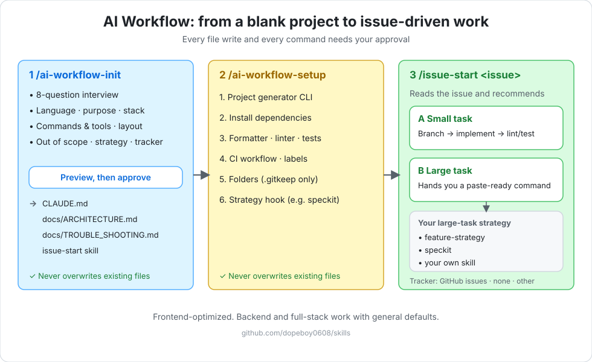

# dopeboy skills

> 🇰🇷 [한국어 README](./README.ko.md)

Agent skills for setting up an AI coding workflow, planning features, refactoring and organizing code. They work in **Claude Code**, **OpenCode**, **Cursor**, **Codex**, **Windsurf**, and any agent that supports the [skills.sh](https://skills.sh) format.

| Skill | What it does |
| --- | --- |
| [`feature-strategy`](./skills/feature-strategy/SKILL.md) | Plans a large, design-heavy feature as "big flow first, details incrementally": requirements on the story, a sub-task roadmap, then one sub-task at a time with a **human check before every commit**. Includes a mock strategy for when the API contract isn't ready. |
| [`fowler-refactor`](./skills/fowler-refactor/SKILL.md) | Applies Martin Fowler's refactoring catalog. It interviews you, proposes a Before/After plan, and changes code only after you approve, with **zero breaking changes** to existing callers. |
| [`code-organizer`](./skills/code-organizer/SKILL.md) | Reorders imports and hook/state/ref/effect declarations in React/TypeScript code **without changing logic**. |
| [`ai-workflow-init`](./skills/ai-workflow-init/SKILL.md) | Generates AI workflow rule documents (`CLAUDE.md`, `docs/ARCHITECTURE.md`, `docs/TROUBLE_SHOOTING.md`, an `issue-start` skill) in a blank or existing project through an 8-question interview. You choose the large-task workflow (`feature-strategy`, `speckit`, your own skill, or none) and the issue tracker (GitHub issues, none, or another). Recommended for first-time adopters of an AI workflow or anyone who wants a minimal setup. Run `/ai-workflow-setup` next. |
| [`ai-workflow-setup`](./skills/ai-workflow-setup/SKILL.md) | Sets up the dev environment after init: scaffolding CLI (with approval), frontend/backend directories, formatter/linter/test tools and CI, and tool checks (`gh`, plugin, the chosen strategy's CLI). Safe to re-run. |

Korean translations of each skill live next to it as `SKILL.ko.md`. They are for humans; agents only read `SKILL.md`.

---

## Install

Pick **one** of the two methods. If you install both in Claude Code, every skill shows up twice.

### Claude Code (plugin)

```bash
claude plugin marketplace add dopeboy0608/skills
claude plugin install dopeboy0608-skills
```

Or inside a session: `/plugin marketplace add dopeboy0608/skills`, then `/plugin install dopeboy0608-skills`, then `/reload-plugins`.

Plugin skills are namespaced: they show up and run as `/dopeboy0608-skills:feature-strategy`, `/dopeboy0608-skills:fowler-refactor`, `/dopeboy0608-skills:code-organizer`, `/dopeboy0608-skills:ai-workflow-init` and `/dopeboy0608-skills:ai-workflow-setup`.

### Any agent (npx)

Works with Claude Code, OpenCode, Cursor, Codex, Windsurf and more. Requires **Node.js >= 22.20.0** (`nvm install 22 && nvm use 22`).

```bash
# Interactive: pick skills and agents (installs into the current project)
npx skills@latest add dopeboy0608/skills

# Global: available in every project
npx skills@latest add dopeboy0608/skills -g

# A single skill
npx skills@latest add dopeboy0608/skills --skill fowler-refactor

# A specific agent
npx skills@latest add dopeboy0608/skills --skill code-organizer --agent opencode
```

Skills installed this way run as `/feature-strategy`, `/fowler-refactor`, `/code-organizer`, `/ai-workflow-init` and `/ai-workflow-setup`. In Claude Code, restart the session or run `/reload-skills` after installing.

### Update

```bash
# Plugin
claude plugin marketplace update dopeboy-skills
claude plugin update dopeboy0608-skills

# npx
npx skills@latest update
```

### Uninstall

```bash
# Plugin
claude plugin uninstall dopeboy0608-skills
claude plugin marketplace remove dopeboy-skills

# npx
npx skills@latest remove fowler-refactor
npx skills@latest remove --global code-organizer
```

---

## feature-strategy

```
/feature-strategy                     # npx
/dopeboy0608-skills:feature-strategy  # Claude plugin
```

It does **not** auto-trigger. Call it explicitly with the command above.

- **Phase A, story pre-definition**: design → requirements doc (screen layout, FRs, fields, policies, open questions) in the story body.
- **Phase B, sub-task planning**: cross-check the story against the code, run question rounds, then create the roadmap and sub-tasks.
- **Phase C, per-sub-task build**: implement one sub-task, stop before commit for your check, then refine the next one.
- The agent gathers facts; you make the decisions. Existing components are replaced, never edited, so rollback is one line.
- Issue-tracker writes (Jira, Linear, ...) happen only after you approve the drafts.

---

## ai-workflow-init / ai-workflow-setup

Recommended for people **adopting an AI workflow for the first time**, or anyone who wants a **minimal setup without complicated configuration**. Run them in order in a blank (or existing) project:

```
/ai-workflow-init                     # npx
/dopeboy0608-skills:ai-workflow-init  # Claude plugin
/ai-workflow-setup                    # npx
/dopeboy0608-skills:ai-workflow-setup # Claude plugin
```



Interactive visual guide (English / 한국어): [open the guide](https://claude.ai/artifact/VqLZoureu5Rr1EnTmx8kc2)

They do **not** auto-trigger. Neither skill clones or reads any external template; everything is bundled in the skill's `references/`.

1. **`ai-workflow-init`**: an 8-question interview (document language, purpose and scope, tech stack, commands, directories, out of scope, large-task workflow, issue tracker), then a **preview of every file** to be written. Nothing is written until you approve, and existing files are never overwritten. It generates `CLAUDE.md`, `docs/ARCHITECTURE.md`, `docs/TROUBLE_SHOOTING.md` and an `issue-start` skill, and re-running it only fills in what is missing.
2. **`ai-workflow-setup`**: detects frontend / backend / full-stack, runs the project scaffolding CLI (for example Vite or Next.js) **after you approve the command**, adds missing directories, sets up the formatter, linter, test runner and CI, syncs `CLAUDE.md` with the real commands and stack, and checks the tools the workflow needs (`gh`, the `dopeboy0608-skills` plugin). Safe to re-run.
3. **`issue-start`** (generated into your project): reads a GitHub issue, recommends a small task (implement directly) or a large task, and for a large task hands you a ready-to-paste command for the strategy you chose (or skips the large-task path if you chose none).

#### How `issue-start` and the large-task skill fit together

`issue-start` is the **entry point for a new issue, used once**. It does not analyze requirements itself.

1. Run `/issue-start <issue>` when you start a new issue. It reads the issue, recommends a small task (A) or a large task (B), and prepares the label and branch.
2. **Small task (A):** the work is done inside `issue-start`; you do not need another skill.
3. **Large task (B):** `issue-start` prints a ready-to-paste command (for example `/feature-strategy Issue #N: ...`). It never starts the strategy skill for you; you run the command.
4. From then on, **continue with the large-task skill, not `issue-start`**. With `feature-strategy`, requirements analysis is its Phase A, planning is Phase B, and implementation is Phase C. Ask it to "start work on issue #N" (or a sub-task) with `/feature-strategy` and it picks the phase from what the issue already contains.
5. Avoid calling `issue-start` again for the same story or for its sub-issues. It is not aware of earlier analysis, so it would classify the issue again and may, for a self-contained sub-issue, recommend a small task and skip the per-sub-task checks of Phase C.

Notes:
- `issue-start` reads the issue body (title, body, labels). It does not open external links such as Figma or Confluence by itself; put the requirements you want considered in the issue body, or give them to the large-task skill, which reads design and spec links.
- A request like "analyze the requirements of issue #N" is not a mode of `issue-start`: it classifies the issue and asks you to choose A or B. For requirements analysis, run the large-task skill (for example `/feature-strategy`).

**Example result** (frontend, `feature-strategy`, GitHub issues, English):

```
my-app/
├── CLAUDE.md                      # rules the agent follows (marker: version, strategy, tracker, stack, lang)
├── docs/
│   ├── ARCHITECTURE.md            # scope, TDD criteria, task routing criteria
│   ├── TROUBLE_SHOOTING.md        # problem-solving log
│   └── history/                   # daily work log (git-ignored)
├── .claude/skills/issue-start/    # reads an issue, recommends small or large task
├── .github/workflows/ci.yml       # lint, typecheck, test, build (optional, after setup)
└── src/                           # empty folders by domain (pages, features, common, api, ...)
```

Summary shown after init: files created or skipped, what the selected strategy needs installed, and the next command (`/ai-workflow-setup`).

This repository is the source of these skills; no external template repository is used. Contributing or testing locally: see the [development guide](./docs/DEVELOPMENT.md).

This workflow is optimized for frontend projects; backend and full-stack work with more general defaults. Supported in this version: large-task workflow `feature-strategy` (recommended for frontend / full-stack), `speckit` (recommended for backend-only), a skill name you type, or none; issue tracker GitHub issues, none (local documents only), or another tracker you name (delegated). The chosen skill must be installed for the large-task path to work; `ai-workflow-setup` checks it and, for `speckit`, can run `specify init --here --integration claude` after your approval.

---

## fowler-refactor

Invoke it explicitly:

```
/fowler-refactor                     # npx
/dopeboy0608-skills:fowler-refactor  # Claude plugin
```

It does **not** auto-trigger. Casual requests like "clean this up" or "refactor this" will not start it; call it explicitly.

1. **Interview** (`grill-me` style): one question at a time, each with a recommended answer, until the target, the smell, and the constraints are clear.
2. **Pattern mapping**: picks patterns from the Fowler catalog (Extract Function, Decompose Conditional, Split Phase, Replace Conditional with Lookup Table, and more).
3. **Proposal report**: a Before/After design with compatibility guarantees, written before any code is touched.
4. **Feedback loop**: code changes only after your explicit approval.
5. **Safe application**: runs type-check and lint, then the formatter on modified files.

Every proposal preserves public signatures, props, and return types, all existing call sites, and observable runtime behaviour.

Pattern catalog: [English](./skills/fowler-refactor/references/fowler-patterns.md) · [한국어](./skills/fowler-refactor/references/fowler-patterns.ko.md)

> Migrating from `dopeboy0608/fowler-refactor-skill`? The skill is now named `fowler-refactor`, so the command is `/fowler-refactor`. Remove the old one with `npx skills@latest remove fowler-refactor-skill`.

## code-organizer

```
/code-organizer                     # npx
/dopeboy0608-skills:code-organizer  # Claude plugin
```

You can also ask "organize imports" or "reorder hooks".

- **Imports**: external packages → app infrastructure (router/store/API) → feature modules → shared components → constants/types/assets. The skill maps these groups to your project's own path aliases. If you already use an import-order lint rule, it follows that rule instead.
- **Component body**: router/store/context → hooks/queries → state → refs → shared memos/handlers → `useLayoutEffect` → `useEffect`.
- Code only moves. Logic, the order of names inside imports, and comments stay exactly as they are.

---

## Credits

- Martin Fowler, *Refactoring: Improving the Design of Existing Code (2nd Edition)*, Addison-Wesley, 2018 · [refactoring.com](https://refactoring.com/catalog/)
- The interview pattern is inspired by Matt Pocock's [`/grill-me`](https://github.com/mattpocock/skills) (MIT).

> This project is an independent community tool. It is not affiliated with or endorsed by Martin Fowler or Pearson Education.

## License

[MIT](./LICENSE) © YongKyu Kim
